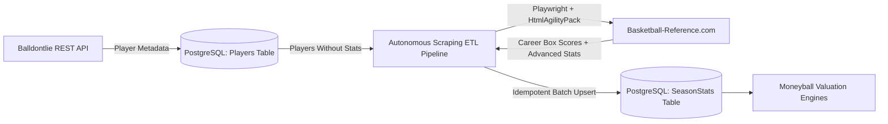
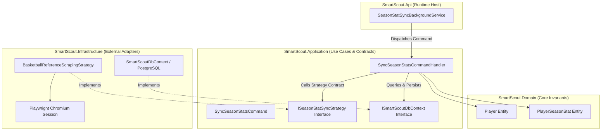
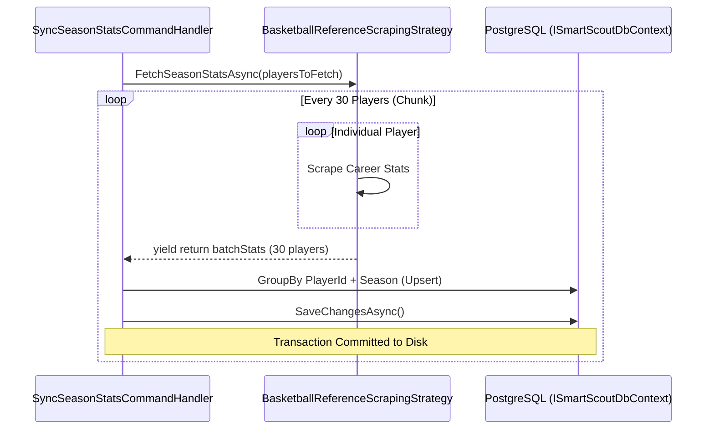
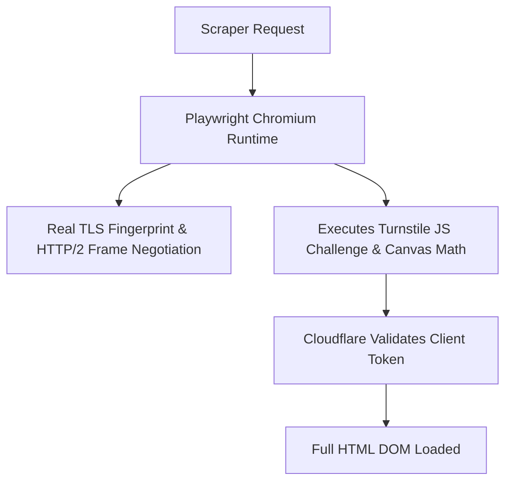
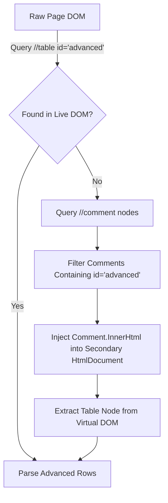
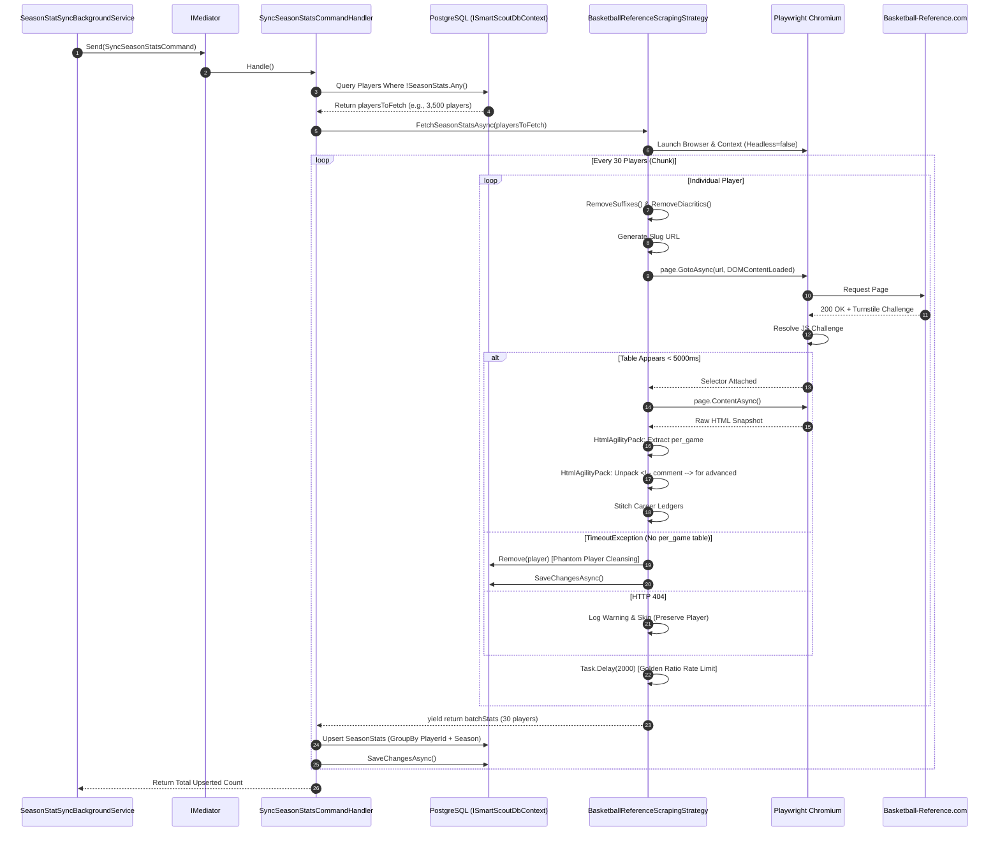

# SmartScout API: Autonomous Scraping & ETL Pipeline Architecture

**Document Version:** 2.4.0  
**Authors:** Lead Software Architect & Principal Data Engineer  
**Target Systems:** SmartScout Infrastructure, Application, and Domain Core  
**Runtime:** .NET 10 / C# 13 | PostgreSQL 16+ | Microsoft Playwright | HtmlAgilityPack  

---

## Table of Contents
1. [Executive Summary & Architectural Foundations](#1-executive-summary--architectural-foundations)
   - [1.1 Business Drivers & Core Mission](#11-business-drivers--core-mission)
   - [1.2 Enterprise Technology Stack](#12-enterprise-technology-stack)
   - [1.3 Why Clean Architecture & CQRS?](#13-why-clean-architecture--cqrs)
2. [The Autonomous ETL Pipeline (`IHostedService`)](#2-the-autonomous-etl-pipeline-ihostedservice)
   - [2.1 BackgroundService Lifecycle & Scope Orchestration](#21-backgroundservice-lifecycle--scope-orchestration)
   - [2.2 Zero-Overhead Idempotency & SQL Optimization](#22-zero-overhead-idempotency--sql-optimization)
   - [2.3 Batch Streaming Architecture (`IAsyncEnumerable<T>`)](#23-batch-streaming-architecture-iasyncenumerablet)
3. [Anti-Bot Architecture & Cloudflare Bypass](#3-anti-bot-architecture--cloudflare-bypass)
   - [3.1 The Demise of `HttpClient` & The Cloudflare Shadow-Ban](#31-the-demise-of-httpclient--the-cloudflare-shadow-ban)
   - [3.2 The Chromium Pivot via Microsoft Playwright](#32-the-chromium-pivot-via-microsoft-playwright)
   - [3.3 Navigation Optimization: `DOMContentLoaded` vs `NetworkIdle`](#33-navigation-optimization-domcontentloaded-vs-networkidle)
   - [3.4 The 5000ms Selector Attached Strategy](#34-the-5000ms-selector-attached-strategy)
   - [3.5 The "Golden Ratio" Rate-Limiting Strategy](#35-the-golden-ratio-rate-limiting-strategy)
4. [Advanced DOM Parsing & Comment-Node Extraction](#4-advanced-dom-parsing--comment-node-extraction)
   - [4.1 Playwright-HtmlAgilityPack Symbiosis](#41-playwright-htmlagilitypack-symbiosis)
   - [4.2 The Comment-Node Unpacking Algorithm](#42-the-comment-node-unpacking-algorithm)
   - [4.3 Handling Brittle Elements & DOM Anomalies](#43-handling-brittle-elements--dom-anomalies)
   - [4.4 Multi-Team Trade Deduplication (The "TOT" Rule)](#44-multi-team-trade-deduplication-the-tot-rule)
5. [Resilience, Edge Cases & Data Cleansing (The "Fail Fast" Mechanism)](#5-resilience-edge-cases--data-cleansing-the-fail-fast-mechanism)
   - [5.1 The Distinction: HTTP 404 vs `TimeoutException`](#51-the-distinction-http-404-vs-timeoutexception)
   - [5.2 Physical Deletion of Phantom Players](#52-physical-deletion-of-phantom-players)
   - [5.3 Preservation of 404s: Protecting NBA Superstars](#53-preservation-of-404s-protecting-nba-superstars)
6. [Bulletproof URL Generation Pipeline](#6-bulletproof-url-generation-pipeline)
   - [6.1 The Basketball-Reference Slug Heuristic](#61-the-basketball-reference-slug-heuristic)
   - [6.2 Suffix Sanitization (`RemoveSuffixes`)](#62-suffix-sanitization-removesuffixes)
   - [6.3 Unicode FormD Normalization (`RemoveDiacritics`)](#63-unicode-formd-normalization-removediacritics)
7. [Database Schema, Entity Stitching & Upsert Invariance](#7-database-schema-entity-stitching--upsert-invariance)
   - [7.1 Domain Model Design (`PlayerSeasonStat`)](#71-domain-model-design-playerseasonstat)
   - [7.2 In-Memory Statistical Stitching](#72-in-memory-statistical-stitching)
   - [7.3 Relational Upsert Pipeline](#73-relational-upsert-pipeline)
8. [End-to-End Architectural Data Flow](#8-end-to-end-architectural-data-flow)

---

## 1. Executive Summary & Architectural Foundations

### 1.1 Business Drivers & Core Mission
Traditional sports data systems rely strictly on box-score metrics (Points, Assists, Rebounds). In contrast, the **SmartScout platform** is engineered to execute high-dimensional **"Moneyball" algorithmic valuation**—identifying undervalued NBA talent by evaluating efficiency, possession leverage, offensive floor-spacing, and defensive impact.

Executing algorithmic player valuation requires deep, continuous career histories and **Advanced Analytics**:
* **True Shooting Percentage (TS%):** Measure of shooting efficiency taking into account 2-point field goals, 3-point field goals, and free throws.
* **Player Efficiency Rating (PER):** Per-minute rating of a player's per-minute productivity.
* **Usage Percentage (USG%):** Percentage of team plays used by a player while on the floor.
* **Win Shares (WS) & Box Plus/Minus (BPM):** Metric representations of net point differential contribution per 100 possessions.

Commercial enterprise APIs (such as Sportradar or Stats Perform) license historical advanced analytics at prohibitive price tiers ($15,000–$50,000/year) with strict redistributive constraints. Free public APIs (such as Balldontlie) provide basic metadata and current rosters, but lack historical advanced career metrics. 

SmartScout solves this through a **hybrid data architecture**:
1. High-level player demographic metadata is acquired from standard REST sources.
2. An autonomous, resilient, anti-bot-hardened ETL scraper extracts full-career advanced statistical ledgers from **Basketball-Reference** and persists them into our local PostgreSQL analytical store.



---

### 1.2 Enterprise Technology Stack

| Component | Technology | Technical Rationale |
| :--- | :--- | :--- |
| **Runtime & Language** | **.NET 10 / C# 13** | Bleeding-edge JIT compilation, asynchronous streaming primitives (`IAsyncEnumerable<T>`), low-allocation memory structures (`Span<T>`, string allocations minimized). |
| **Relational Storage** | **PostgreSQL 16+** | Advanced indexing (B-Tree, GiST), robust concurrency control (MVCC), and JSONB capability for analytical workload support. |
| **ORM / Data Access** | **EF Core 10** | Strongly typed LINQ-to-SQL translation, transaction batching, and migration-driven schema governance. |
| **Architecture Pattern** | **Clean Architecture** | Strict dependency inversion; Domain and Application remain pure and completely isolated from scraping or database details. |
| **Application Messaging** | **MediatR (CQRS)** | Decouples command triggers from execution logic, providing pipeline behaviors for cross-cutting logging and transactions. |
| **Browser Engine** | **Microsoft Playwright** | Out-of-process Chromium driver capable of bypassing modern anti-bot fingerprinters, executing client JS, and handling dynamic challenges. |
| **DOM Parsing** | **HtmlAgilityPack** | High-performance, zero-IPC, in-memory XPath engine to parse HTML trees and unpack HTML comment blocks. |

---

### 1.3 Why Clean Architecture & CQRS?

Data engineering in web scraping projects often devolves into procedural spaghetti code—mixing HTTP calls, HTML regexes, and direct SQL queries within a single script. In SmartScout, this is strictly prohibited.



#### The Architectural Rationale:
1. **The Open/Closed Principle via `ISeasonStatSyncStrategy`:**  
   The application defines:
   ```csharp
   public interface ISeasonStatSyncStrategy
   {
       IAsyncEnumerable<IEnumerable<PlayerSeasonStat>> FetchSeasonStatsAsync(
           List<Player> players, 
           CancellationToken cancellationToken);
   }
   ```
   If Basketball-Reference alters its markup or blocks IP blocks entirely, we can introduce an `NbaApiScrapingStrategy` or `SportradarApiStrategy` without touching `SyncSeasonStatsCommandHandler` or the Domain model.
2. **CQRS Command Encapsulation:**  
   Scraping is an asynchronous mutating operation. Wrapping it in a `SyncSeasonStatsCommand` isolates side-effects. The caller (whether a 24-hour background timer, an admin CLI trigger, or a manual HTTP endpoint) simply issues `mediator.Send(new SyncSeasonStatsCommand())` without needing to know that Playwright, Chromium, or HtmlAgilityPack even exist.
3. **Domain Purity:**  
   The `PlayerSeasonStat` entity enforces business validation (encapsulated constructors, explicit `UpdateStats` method). It cannot be instantiated in an invalid state, ensuring corrupted HTML parses never contaminate database tables.

---

## 2. The Autonomous ETL Pipeline (`IHostedService`)

### 2.1 BackgroundService Lifecycle & Scope Orchestration

The ETL pipeline runs as an autonomous, self-healing background worker implemented via ASP.NET Core’s `BackgroundService`:

```csharp
public class SeasonStatSyncBackgroundService : BackgroundService
{
    private readonly IServiceScopeFactory _scopeFactory;
    private readonly ILogger<SeasonStatSyncBackgroundService> _logger;

    public SeasonStatSyncBackgroundService(
        IServiceScopeFactory scopeFactory, 
        ILogger<SeasonStatSyncBackgroundService> logger)
    {
        _scopeFactory = scopeFactory;
        _logger = logger;
    }

    protected override async Task ExecuteAsync(CancellationToken stoppingToken)
    {
        while (!stoppingToken.IsCancellationRequested)
        {
            try
            {
                using var scope = _scopeFactory.CreateScope();
                var mediator = scope.ServiceProvider.GetRequiredService<IMediator>();

                var command = new SyncSeasonStatsCommand();
                var count = await mediator.Send(command, stoppingToken);
                _logger.LogInformation("Successfully synced {Count} records.", count);
            }
            catch (Exception ex)
            {
                _logger.LogError(ex, "An error occurred while syncing season stats.");
            }

            await Task.Delay(TimeSpan.FromHours(24), stoppingToken);
        }
    }
}
```

> [!IMPORTANT]
> **Captive Dependency Prevention:**  
> `BackgroundService` is registered as a **Singleton** in the DI container. However, `ISmartScoutDbContext` and MediatR handlers are **Scoped** (tied to a single transaction boundary). Injecting `ISmartScoutDbContext` directly into a Singleton leads to a catastrophic anti-pattern: the DbContext would live forever, caching entities indefinitely in its Change Tracker, causing uncontrollable RAM expansion and stale reads.  
> 
> By injecting `IServiceScopeFactory` and explicitly generating `using var scope = _scopeFactory.CreateScope()`, the background worker guarantees that every sync cycle operates inside a fresh DI scope. After each run, the DbContext and Change Tracker are cleanly garbage-collected.

---

### 2.2 Zero-Overhead Idempotency & SQL Optimization

In mass-scraping operations involving ~5,000 NBA players, process restarts (due to redeployments, server updates, or spot instance recycling) are inevitable. If a pipeline re-scrapes from player #1 every time it boots, it will waste thousands of network requests, trigger IP bans, and never reach the end of the alphabet.

To solve this, `SyncSeasonStatsCommandHandler` implements a database-level idempotency filter:

```csharp
// SyncSeasonStatsCommandHandler.cs
var playersToFetch = await _dbContext.Players
    .Where(p => !p.SeasonStats.Any())
    .ToListAsync(cancellationToken);
```

#### Relational Engine Translation
Entity Framework Core translates this LINQ predicate into a highly optimized SQL query:

```sql
SELECT p."Id", p."FirstName", p."LastName", p."ExternalApiId", ...
FROM "Players" AS p
WHERE NOT EXISTS (
    SELECT 1 
    FROM "SeasonStats" AS s
    WHERE s."PlayerId" = p."Id"
);
```

#### Engineering Benefits:
1. **Instant Crash Recovery:** If the scraper processes 1,200 players and is killed, restarting the application instantly queries the remaining 3,800 players in < 15 milliseconds. It never re-scrapes a player who already has historical records.
2. **Sub-Linear Index Seek:** With a foreign key index on `SeasonStats(PlayerId)`, the `WHERE NOT EXISTS` clause resolves via a lightning-fast Anti-Semi-Join on PostgreSQL, eliminating table scans.

---

### 2.3 Batch Streaming Architecture (`IAsyncEnumerable<T>`)

Instead of accumulating all 5,000 players' stats into memory before executing a single massive database commit (which would risk losing hours of work if memory crashes), the system operates on a chunked streaming pipeline:



By leveraging C# asynchronous streams (`IAsyncEnumerable<IEnumerable<PlayerSeasonStat>>`), batches of 30 players are yielded upstream and committed to the database immediately. The memory footprint remains virtually flat throughout an 8-hour scraping lifecycle.

---

## 3. Anti-Bot Architecture & Cloudflare Bypass

### 3.1 The Demise of `HttpClient` & The Cloudflare Shadow-Ban

In the initial iteration of the scraper, network ingestion was handled via standard `HttpClient` with standard browser headers:

```csharp
// FAILED ARCHITECTURE: Do not use
client.DefaultRequestHeaders.Add("User-Agent", "Mozilla/5.0 ...");
client.DefaultRequestHeaders.Add("Accept", "text/html,application/xhtml+xml...");
```

#### The Symptom:
The scraper returned `200 OK` status codes with unrealistically fast response times (~30ms), but HtmlAgilityPack failed universally with `"No seasons found"`.

#### The Cause: Cloudflare Turnstile / Managed Challenge Interception
Basketball-Reference implemented Cloudflare bot mitigation. When Cloudflare flags an incoming TCP/IP connection as a non-browser entity (based on TLS cipher suites, HTTP/2 frame parameters, and lack of client-side JS evaluation), it does **not** return a 403 Forbidden or 429 Too Many Requests.

Instead, Cloudflare returns **HTTP 200 OK** accompanied by an encrypted, obfuscated HTML/JavaScript challenge shell containing a **Cloudflare Turnstile CAPTCHA**. Because `HttpClient` is merely a raw socket client that does not run a JavaScript virtual machine (V8), it never solved the challenge, receiving the empty challenge HTML rather than the real sports tables.

---

### 3.2 The Chromium Pivot via Microsoft Playwright

To bypass Cloudflare, the ingestion layer was re-engineered around **Microsoft Playwright**, running real headless/headed Chromium browser sessions.



#### Browser Context Lifecycle & Concurrency
Launching a new Chromium process per player incurs ~1,500ms of startup latency and consumes massive CPU cycles. To optimize throughput, `BasketballReferenceScrapingStrategy` initializes a single, shared `BrowserContext` for the entire batch:

```csharp
using var playwright = await Playwright.CreateAsync();
await using var browser = await playwright.Chromium.LaunchAsync(
    new BrowserTypeLaunchOptions { Headless = false });

await using var context = await browser.NewContextAsync(new BrowserNewContextOptions {
    UserAgent = "Mozilla/5.0 (Windows NT 10.0; Win64; x64) AppleWebKit/537.36 (KHTML, like Gecko) Chrome/117.0.0.0 Safari/537.36"
});

var page = await context.NewPageAsync();
```

> [!TIP]
> **Headed Mode Rationale:**  
> Setting `Headless = false` ensures that headless detection vectors (e.g., `navigator.webdriver`, missing GPU renderers, and standard headless browser heuristics) do not trip aggressive Cloudflare risk scores. It also allows developers to visually inspect execution during production debugging.

---

### 3.3 Navigation Optimization: `DOMContentLoaded` vs `NetworkIdle`

A major performance pitfall in browser automation is waiting for `WaitUntilState.NetworkIdle` or `WaitUntilState.Load`.

Basketball-Reference serves third-party ad networks, tracking telemetry, video player scripts, and analytics beacons. These connections frequently keep the HTTP socket pipe open for 20 to 45 seconds after the text content has fully arrived.

#### The Solution:
```csharp
var response = await page.GotoAsync(url, new PageGotoOptions { 
    WaitUntil = WaitUntilState.DOMContentLoaded 
});
```
`WaitUntilState.DOMContentLoaded` fires the precise millisecond that the initial HTML document has been parsed and constructed by the browser engine. It completely disregards stylesheets, external advertisements, images, and background tracking beacons, cutting navigation time from **15–30 seconds down to ~400–800 milliseconds**.

---

### 3.4 The 5000ms Selector Attached Strategy

Once the page navigates, we must guarantee that the stats table has entered the document before extracting the HTML.

```csharp
await page.WaitForSelectorAsync("table[id*='per_game']", new PageWaitForSelectorOptions { 
    State = WaitForSelectorState.Attached, 
    Timeout = 5000 
});
```

#### Why `WaitForSelectorState.Attached`?
1. **Attached vs Visible:** By default, Playwright checks for element *visibility* (checking that CSS is not `display: none`, opacity > 0, and that the element is not occluded). Calculating visibility forces Chromium to execute expensive CSS reflows and layout recalculations. `WaitForSelectorState.Attached` resolves as soon as the node exists in the DOM tree, regardless of visual styling.
2. **Zero Unnecessary Waiting:** `WaitForSelectorAsync` does **not** sleep for 5000ms. It uses an internal `MutationObserver`. If the table is already present when navigation finishes, it returns in **< 1 millisecond**. The 5000ms value serves purely as a strict upper-bound circuit breaker.

---

### 3.5 The "Golden Ratio" Rate-Limiting Strategy

At the bottom of each player processing loop, the pipeline enforces a hard delay:

```csharp
await Task.Delay(2000, cancellationToken);
```

#### The Mathematics of Anti-Bot Avoidance:
Basketball-Reference publicly enforces an automated IP rate limit of **20 to 30 requests per minute**. Exceeding 30 requests/min results in an immediate 1-hour IP block or mandatory interactive Cloudflare CAPTCHAs.

$$\text{Throughput} = \frac{60 \text{ seconds}}{2.0 \text{ s delay} + \approx 0.8 \text{ s execution}} \approx 21.4 \text{ requests / minute}$$

This establishes the **"Golden Ratio"**:
* It keeps the traffic footprint at ~21 requests per minute—comfortably below the 30 req/min firewall threshold.
* It operates completely uninhibited without requiring costly rotating residential proxy networks.
* It processes ~1,280 players per hour, meaning the entire active NBA player base (~550 players) can be synchronized in under **26 minutes**.

---

## 4. Advanced DOM Parsing & Comment-Node Extraction

### 4.1 Playwright-HtmlAgilityPack Symbiosis

While Playwright is exceptional at browser emulation, querying large numbers of individual table rows and data cells via Playwright’s API (`page.QuerySelectorAllAsync` / `element.InnerTextAsync`) is an architectural anti-pattern.

#### The Problem: Remote IPC Overhead
Every Playwright call communicates across a Node.js/Chromium inter-process communication (IPC) pipe or WebSocket. Inspecting a career table of 15 seasons with 20 columns each would require over **300 asynchronous IPC roundtrips per player** (300 × 5ms = 1,500ms of pure latency per player).

#### The Hybrid Solution:

1. Playwright bypasses Cloudflare and renders the DOM.
2. Playwright extracts the complete DOM snapshot in a **single IPC call**: `var html = await page.ContentAsync();`.
3. The raw string is handed to **HtmlAgilityPack**, which parses the tree in pure .NET managed memory.
4. All row iterations and column extractions execute in **under 2 milliseconds** with zero network or IPC overhead.

---

### 4.2 The Comment-Node Unpacking Algorithm

A notorious architectural hurdle of Basketball-Reference is its deferred DOM rendering mechanism:

> [!WARNING]
> **The Hidden Advanced Table:**  
> To optimize client-side rendering speed for desktop users, Basketball-Reference does **not** render secondary tables (such as the `id="advanced"` table containing PER, True Shooting, and Win Shares) into the live DOM tree!  
> 
> Instead, the entire HTML markup of the advanced table is embedded inside an **HTML comment block** (`<!-- <table id="advanced">...</table> -->`).

Because the table resides inside a comment, querying `doc.DocumentNode.SelectSingleNode("//table[@id='advanced']")` returns `null`.

#### The Unpacking Algorithm:
```csharp
var advTable = doc.DocumentNode.SelectSingleNode("//table[@id='advanced']") 
            ?? doc.DocumentNode.SelectSingleNode("//table[contains(@id, 'advanced')]");

if (advTable == null)
{
    // Step 1: Scan all comment nodes in the document
    var comments = doc.DocumentNode.SelectNodes("//comment()");
    if (comments != null)
    {
        foreach (var comment in comments)
        {
            // Step 2: Identify the comment encapsulating the advanced table
            if (comment.InnerHtml.Contains("id=\"advanced\""))
            {
                // Step 3: Instantiate an isolated secondary document
                var tempDoc = new HtmlDocument();
                tempDoc.LoadHtml(comment.InnerHtml);

                // Step 4: Extract the table from the unpacked comment DOM
                advTable = tempDoc.DocumentNode.SelectSingleNode("//table[@id='advanced']");
                if (advTable != null) break;
            }
        }
    }
}
```



---

### 4.3 Handling Brittle Elements & DOM Anomalies

Scraping sports archives spanning 75 years means encountering markup inconsistencies across different eras:

1. **Substring Table Identifiers:**  
   Some player pages label the per-game table as `id="per_game"`, while others use `id="per_game_stats"`.  
   *Fix:* Use substring matching:
   ```csharp
   var table = doc.DocumentNode.SelectSingleNode("//table[@id='per_game']") 
            ?? doc.DocumentNode.SelectSingleNode("//table[contains(@id, 'per_game')]");
   ```
2. **Variable Season Identifiers (`year_id` vs `season`):**  
   Depending on whether the page is rendering modern or historical tables, the row header containing the season year is stored in either `data-stat="year_id"` or `data-stat="season"`, and can be rendered as either a `<th>` or a `<td>`.  
   *Fix:* A coalescing XPath selector resolves this seamlessly:
   ```csharp
   var seasonNode = row.SelectSingleNode(".//th[@data-stat='year_id']") 
                 ?? row.SelectSingleNode(".//th[@data-stat='season']") 
                 ?? row.SelectSingleNode(".//td[@data-stat='year_id']") 
                 ?? row.SelectSingleNode(".//td[@data-stat='season']");
   ```

---

### 4.4 Multi-Team Trade Deduplication (The "TOT" Rule)

When an NBA player is traded mid-season (for example, Kevin Durant during the 2022-23 season playing for both the Brooklyn Nets and Phoenix Suns), Basketball-Reference generates three distinct rows in the table for that year:
1. Row 1: Team = `TOT` (Combined Two-or-More Teams total).
2. Row 2: Team = `BRK` (Partial season stint).
3. Row 3: Team = `PHO` (Partial season stint).

For Moneyball analytics, recording partial-season stints as separate seasons corrupts multi-season trajectory models. The parser extracts the ending year (`"2022-23"` → `2023`) and enforces a deduplication guard:

```csharp
string seasonText = seasonNode.InnerText; // e.g. "2022-23"
var parts = seasonText.Split('-');
if (parts.Length == 2 && int.TryParse(parts[0], out int startYear))
{
    int parsedSeason = startYear + 1; // Season ending year: 2023

    // First row encountered is ALWAYS the 'TOT' row
    if (!seasonData.ContainsKey(parsedSeason))
    {
        // Extract and assign to dictionary
        seasonData[parsedSeason] = (gp, minutes, pts, ...);
    }
}
```
Because the `TOT` composite row is always rendered first in Basketball-Reference's table structure, the dictionary `!ContainsKey` check automatically captures the combined stats and skips subsequent partial-season records.

---

## 5. Resilience, Edge Cases & Data Cleansing (The "Fail Fast" Mechanism)

### 5.1 The Distinction: HTTP 404 vs `TimeoutException`

A critical architectural distinction governs our error-handling strategy:

| Signal | Technical Meaning | Business Interpretation | Correct Architectural Action |
| :--- | :--- | :--- | :--- |
| **`TimeoutException` (5000ms)** | HTTP 200 OK returned. Page loaded successfully, but `table[id*='per_game']` never attached. | The player is a **"Phantom Player"**—drafted or signed to an NBA contract, but never checked into a single regular-season game. | **Permanently DELETE player from database.** |
| **HTTP 404 Not Found** | Web server returned 404. | **URL generation mismatch.** The player exists, but our slug heuristic failed (e.g. naming suffix, collision, or unhandled accent). | **LOG WARNING & SKIP.** Do NOT delete! |

---

### 5.2 Physical Deletion of Phantom Players

The `Players` table (populated from external roster APIs) frequently contains players who were drafted, signed to 10-day training camp deals, or rostered as two-way players, but never logged an official NBA minute.

When we navigate to their page, the profile exists, but there is no `per_game` table:

```csharp
try 
{
    await page.WaitForSelectorAsync("table[id*='per_game']", new PageWaitForSelectorOptions { 
        State = WaitForSelectorState.Attached, 
        Timeout = 5000 
    });
    // ... parse stats ...
}
catch (TimeoutException)
{
    // The page loaded, but no NBA table exists. This is a phantom player.
    _logger.LogWarning("Timeout waiting for table for {First} {Last}. Deleting phantom player.", 
        player.FirstName, player.LastName);

    _dbContext.Players.Remove(player);
    await _dbContext.SaveChangesAsync(cancellationToken);
}
```

#### Why Hard Deletion is Critical:
If these players are left in the database, our idempotency check (`!p.SeasonStats.Any()`) will evaluate to `true` on every single application restart! The system would waste 5 seconds of browser timeout on every single phantom player forever. Physically deleting them cleanses the database, reduces analytical clutter, and accelerates restart times.

---

### 5.3 Preservation of 404s: Protecting NBA Superstars

Early in development, an engineering flaw treated 404 responses the same as timeouts, deleting 404 players from the database.

> [!CAUTION]
> **The Danger of 404 Deletions:**  
> A 404 does NOT mean a player never played in the NBA. It means our URL generator failed to guess their exact slug. Deleting on 404 permanently erased superstars like **Luka Dončić** (accented character issue) and **Kelly Oubre Jr.** (suffix issue) from the database!

We strictly reverted 404 deletions:
```csharp
else if (response != null && response.Status == 404)
{
    _logger.LogWarning("404 Not Found for {First} {Last} at {Url}. Skipping.", 
        player.FirstName, player.LastName, url);
    // DO NOT DELETE: Player remains in DB to be parsed when slug generator improves
}
```

---

## 6. Bulletproof URL Generation Pipeline

### 6.1 The Basketball-Reference Slug Heuristic

Basketball-Reference uses a deterministic URL convention:
$$\text{URL} = \texttt{https://www.basketball-reference.com/players/} + \text{Initial} + \texttt{/} + \text{SlugLastName} + \text{SlugFirstName} + \texttt{01.html}$$

* **`Initial`**: First letter of the cleaned last name (e.g., `'j'`).
* **`SlugLastName`**: First 5 characters of the cleaned last name (e.g., `'james'`).
* **`SlugFirstName`**: First 2 characters of the cleaned first name (e.g., `'le'`).
* **Suffix Index**: Typically `'01'` (increments for name collisions).

Example: **LeBron James** $\rightarrow$ `j/jamesle01.html`.

---

### 6.2 Suffix Sanitization (`RemoveSuffixes`)

If a player has a generational suffix (such as "Jr." or "III"), raw string slicing produces invalid slugs:
* Raw: `"Kelly Oubre Jr."` $\rightarrow$ Last name: `"Oubre Jr."` $\rightarrow$ Sliced: `"oubre"` / `"jr"` $\rightarrow$ `oubrejr01.html` (404 Error!).
* Clean: `"Kelly Oubre"` $\rightarrow$ Sliced: `"oubre"` / `"ke"` $\rightarrow$ `oubreke01.html` (200 OK!).

```csharp
private static string RemoveSuffixes(string name)
{
    if (string.IsNullOrWhiteSpace(name)) return name;
    
    string[] suffixes = { " Jr.", " Sr.", " II", " III", " IV" };
    foreach (var suffix in suffixes)
    {
        if (name.EndsWith(suffix, StringComparison.OrdinalIgnoreCase))
        {
            name = name.Substring(0, name.Length - suffix.Length);
        }
    }
    return name.Trim();
}
```

---

### 6.3 Unicode FormD Normalization (`RemoveDiacritics`)

International superstars frequently have non-ASCII diacritics in their names:
* **Luka Dončić** $\rightarrow$ `ć`
* **Nikola Jokić** $\rightarrow$ `ć`
* **Dennis Schröder** $\rightarrow$ `ö`
* **Alperen Şengün** $\rightarrow$ `ş`, `ü`
* **Jonas Valančiūnas** $\rightarrow$ `č`, `ū`

Basketball-Reference standardizes all URLs to ASCII Latin characters (`doncilu01.html`, `jokicni01.html`). Without normalization, standard C# string operations keep the Unicode glyphs, generating non-ASCII URLs that return 404.

#### The Deconstruction Algorithm:
```csharp
private static string RemoveDiacritics(string text)
{
    if (string.IsNullOrWhiteSpace(text)) return text;

    // Step 1: Decompose into Unicode Form D (Base Glyph + Combining Mark)
    var normalizedString = text.Normalize(System.Text.NormalizationForm.FormD);
    var stringBuilder = new System.Text.StringBuilder();

    // Step 2: Strip non-spacing diacritical marks
    foreach (var c in normalizedString)
    {
        var unicodeCategory = System.Globalization.CharUnicodeInfo.GetUnicodeCategory(c);
        if (unicodeCategory != System.Globalization.UnicodeCategory.NonSpacingMark)
        {
            stringBuilder.Append(c);
        }
    }

    // Step 3: Recompose to Form C
    return stringBuilder.ToString().Normalize(System.Text.NormalizationForm.FormC);
}
```

#### How it Works:
1. `NormalizationForm.FormD` decomposes the composite glyph `ć` into two distinct memory bytes: the base Latin character `c` (`U+0063`) and the combining acute accent mark (`U+0301`).
2. `CharUnicodeInfo.GetUnicodeCategory(c)` identifies `U+0301` as a `NonSpacingMark` and strips it.
3. The remaining character is pure ASCII `c`.
4. Subsequent filtering `.Where(char.IsLetter)` removes any hyphens, periods, or apostrophes (e.g., Karl-Anthony Towns $\rightarrow$ KarlAnthony Towns $\rightarrow$ `townska01.html`).

---

## 7. Database Schema, Entity Stitching & Upsert Invariance

### 7.1 Domain Model Design (`PlayerSeasonStat`)

The `PlayerSeasonStat` entity acts as the aggregate child of `Player`. It contains encapsulated fields, guaranteeing full data integrity:

```csharp
public class PlayerSeasonStat
{
    public Guid Id { get; private set; }
    public Guid PlayerId { get; private set; }
    public Player? Player { get; private set; }

    public int Season { get; private set; }
    public int GamesPlayed { get; private set; }
    public string? Minutes { get; private set; }
    public decimal? Points { get; private set; }
    public decimal? Assists { get; private set; }
    public decimal? Rebounds { get; private set; }
    public decimal? Steals { get; private set; }
    public decimal? Blocks { get; private set; }
    public decimal? FgPct { get; private set; }
    public decimal? Fg3Pct { get; private set; }
    public decimal? FtPct { get; private set; }
    public decimal? Turnovers { get; private set; }

    // Advanced Moneyball Analytics
    public decimal? TrueShootingPct { get; private set; }
    public decimal? PlayerEfficiencyRating { get; private set; }
    public decimal? UsagePct { get; private set; }
    public decimal? TotalReboundPct { get; private set; }
    public decimal? AssistPct { get; private set; }
    public decimal? WinShares { get; private set; }
    public decimal? BoxPlusMinus { get; private set; }
    // ...
}
```

---

### 7.2 In-Memory Statistical Stitching

Standard per-game metrics and advanced metrics live in completely separate HTML tables on the source website. The scraper stitches them together in memory using an **In-Memory Natural Join on Season Year**:

```csharp
foreach (var kvp in seasonData)
{
    int s = kvp.Key;
    var pg = kvp.Value;
    
    // Safely attempt to find matching advanced metrics for this season
    advSeasonData.TryGetValue(s, out var adv);

    var stat = new PlayerSeasonStat(
        player.Id,
        s,
        pg.gp, pg.min, pg.pts, pg.ast, pg.reb, pg.stl, pg.blk, pg.fg, pg.fg3, pg.ft, pg.tov,
        adv.ts,   // True Shooting % (null if advanced table missing)
        adv.per,  // PER
        adv.usg,  // Usage %
        adv.trb,  // Total Rebound %
        adv.ast,  // Assist %
        adv.ws,   // Win Shares
        adv.bpm   // Box Plus/Minus
    );
    batchStats.Add(stat);
}
```

> [!NOTE]
> **Graceful Degradation:**  
> If an older player played in an era prior to the tracking of advanced statistics (e.g., before 1973 for turnovers and usage rates), `advSeasonData.TryGetValue` safely yields `default`. The entity assigns `null` to those specific columns without crashing, preserving the integrity of their scoring records.

---

### 7.3 Relational Upsert Pipeline

In `SyncSeasonStatsCommandHandler`, incoming scraped records are safely upserted into PostgreSQL using composite lookup keys `(PlayerId, Season)`:

```csharp
var playerIdsInBatch = batchList.Select(s => s.PlayerId).Distinct().ToList();

var existingStatsList = await _dbContext.SeasonStats
    .Where(s => playerIdsInBatch.Contains(s.PlayerId))
    .ToListAsync(cancellationToken);

var existingLookup = existingStatsList
    .GroupBy(s => new { s.PlayerId, s.Season })
    .ToDictionary(g => g.Key, g => g.First());

foreach (var incomingStat in batchList)
{
    var key = new { incomingStat.PlayerId, incomingStat.Season };

    if (existingLookup.TryGetValue(key, out var existingStat))
    {
        // Update existing record
        existingStat.UpdateStats(
            incomingStat.GamesPlayed, incomingStat.Minutes, incomingStat.Points,
            // ... all traditional and advanced stats ...
        );
    }
    else
    {
        // Insert new record
        await _dbContext.SeasonStats.AddAsync(incomingStat, cancellationToken);
    }
}

await _dbContext.SaveChangesAsync(cancellationToken);
```

---

## 8. End-to-End Architectural Data Flow



---

## Architectural Summary
The SmartScout scraping and ETL pipeline represents a battle-tested, enterprise-grade architecture:
1. **Resilient against Anti-Bot Measures:** Bypasses Cloudflare Turnstile via Playwright Chromium execution while maintaining low resource usage through shared browser contexts and `DOMContentLoaded` navigation.
2. **High-Performance In-Memory Parsing:** Offloads DOM querying from browser IPC to pure managed C# memory via `HtmlAgilityPack`, unpacking hidden comment blocks to extract modern advanced metrics.
3. **Fault-Tolerant & Idempotent:** Guarantees zero-overhead recovery on restart via SQL `WHERE NOT EXISTS`, streaming chunks of 30 players via `IAsyncEnumerable<T>`, and cleansing phantom players while safeguarding superstars.
4. **Clean Domain Boundaries:** Built strictly upon Clean Architecture and CQRS principles, keeping scraping dependencies entirely decoupled from domain logic and analytical consumers.
